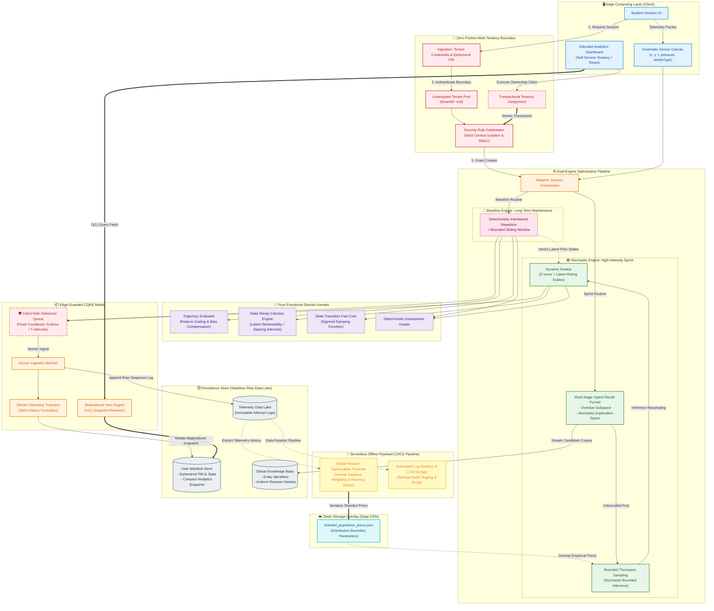

# Budget-Constrained Adaptive Learning Architecture with Edge-Guarded CQRS

© 2026. All rights reserved.

> **🔒 Proprietary & Commercialization Notice:** The core source code, exact reward functions, automated routing mechanics, and contextual word-masking algorithms of this system are strictly maintained in a secure, **private repository**. This absolute code isolation is legally and commercially mandatory for two reasons: (1) **Anti-Cheat & Vulnerability Prevention:** The platform embeds proprietary, stem-aware parsing regex engines designed around the official question banks of the **National English Spelling Competition ("全國英語單字王大賽")** in Taiwan. Open-sourcing the repository would expose the underlying validation logic, allowing tech-savvy students to extract raw answer lists or bypass context-masking filters via API reverse-engineering, destroying competition integrity. (2) **Commercial B2B Architecture Protection:** The "Zero-IT-Overhead" pipeline—enabling non-technical educators to dynamically update nationwide competition banks by merely dropping a spreadsheet into a git-tree—is a proprietary trade secret. This public file serves exclusively as an obfuscated architectural blueprint and empirical portfolio review.

## 0. Operational Context & Empirical Learning Outcomes:
Deployed during my teaching practicum, this adaptive framework supported the school's spelling bee cohort, raising their Level 3 vocabulary accuracy from a 40% baseline to a sustainable 75%–80% success rate.

---

## 1. Pedagogical Pain Points & Budget-Driven Engineering

### A. The Target Constraint Hierarchy (The National Competition Boundary)
This adaptive, offline-friendly training infrastructure was engineered specifically to train elite student cohorts for the standardized annual **National English Spelling Competition ("全國英語單字王大賽")** across all administrative regions in Taiwan. The target competition operates under a high-pressure elimination format: a foreign instructor reads a word and its corresponding example sentence; students have a strict 8-second horizon to write the answer on a physical canvas; any erasure, modification, or delayed stroke triggers an automatic disqualification. 

To bridge the gap between static study and high-stress elimination, the system enforces a strict operational parallel:
* **Dynamic Interleaved Spaced Repetition (SM-2 Variant):** Routes practice slots exclusively toward individual lexical weak spots, preventing time dispersion on mastered vocabulary.
* **Deterministic Non-Self-Reported Grading:** Bypasses superficial user self-assessment by passing canvas trajectories through real-time handwriting recognition engines, scoring strictly against correct strings and timestamp latencies.
* **Stem-Aware Contextual Masking:** To prevent answer leakage from example sentences, the engine dynamically isolates and masks target words using stem-aware structural tokens (rather than naive string replacement), revealing context only post-submission.

### B. Scalability under Extreme Budget Constraints
Unlike heavily funded enterprise SaaS models, this platform supports **15,000+ cognitive telemetry data points generated by 7 active concurrent users** under a **strict zero-infrastructure-budget limit**. During synchronous classroom spelling sprints, high-frequency handwriting stroke appends create severe write amplification. 

While early-stage testing captured 15,000+ cognitive telemetry data points generated across a baseline cohort of 7 concurrent active users, the architecture was engineered to scale seamlessly for whole-grade synchronous evaluations involving 500+ student clients simultaneously.
To manage high-frequency writes from concurrent student spelling sprints under zero-budget constraints, the platform employs an Edge-Guarded CQRS paradigm that splits ingestion and reading processes:

• Command Side (Ingestion): Client-side edge queues buffer and compress continuous inputs into sparse atomic batches sent to a stateless telemetry data lake to prevent server bottlenecks.

• Query Side (Read Model): An asynchronous analytics engine pre-aggregates offline data, allowing leaderboards and admin consoles to read from materialized views served via an edge CDN cache.

---

## 2. End-to-End System Topology

The pipeline utilizes client-side edge computing, deterministic-stochastic dual-engine routing, isolated pure domain algorithms, and an automated serverless flywheel to preserve persistence cycles.

---

## 3. Core Architectural Mechanisms

### A. Dual-Engine Prior Inheritance (Exploration-Exploitation)
To optimize long-term cognitive modeling alongside explosive multi-user training bursts, the system orchestrates an asynchronous prior-inheritance bridge. The *Baseline Engine* establishes highly stable retention decay parameters using deterministic interleaved repetition matrix tracking. When a user switches to a high-intensity session, the *Stochastic Engine* maps these parameter inputs as empirical prior vectors ($\alpha, \beta$) into a *Bounded Thompson Sampling* loop. This guarantees balanced stochastic exploration without experiencing common cold-start evaluation failures.

### B. Client-Side Debounce & Atomic Ingestion CQRS
Engineered an edge-computing training system specifically for low-bandwidth, legacy school computer labs. Mitigated severe write amplification and network latency via a client-side Edge Debounce Queue, keeping runtime overhead at absolute zero for institutional deployment.

Upon flushing, the AttemptBatcher executes an immutable append operation to the raw telemetry data lake. Simultaneously, an asynchronous stream truncator calculates a condensed 30-item sliding footprint, writing a localized User Manifest Store snapshot. This ensures that administrative dashboards can extract real-time tracking metrics at deterministic $O(1)$ query execution bounds.

C. Serverless Offline Flywheel Integration

Calculating cross-user distribution metrics and normalization transformations is moved out of the live request cycle entirely. An automated, scheduled asynchronous task flow (GitHub Actions Flywheel) extracts large-scale raw performance histories, processes composite Recency Decays and Inverse Variance Weightings offline, and compiles the outcomes into compressed static files (sharded_population_priors.json). These configuration files are overlaid onto the production ranks at runtime via edge nodes, eliminating live calculation costs.

## 4. Product Validation, Field Observations & Data Analysis

### A. The 2026-10-13 Cognitive Transfer Effect
Rather than building generic flashcard features, the development cycle prioritized qualitative field discovery over feature-bloat, gathering hands-on feedback through user interviews and live tracking across a small, known cohort. During an on-site pilot session on October 13, 2026, an unexpected behavioral pattern emerged: students who had been dynamically pushed to advanced tier boundaries (Levels 4–6) by the DDA engine, and then abruptly pulled back to Level 3 via the "Competition Sprint Mode" two weeks prior to the event, exhibited noticeably faster kinematic responses. 

Students bypassed conscious cognitive recall, executing handwriting strokes *automatically* upon stimuli presentation. This validated a three-layer psychological stack under active deployment: 
`DDA Bound Push (L4-L6) -> Sprint Demotion (L3 Dimensional Reduction) -> SM-2 Inconsistency Anchoring`. 
Academically, this provides a real-world case study of **Desirable Difficulty**, **Transfer of Training**, and **Automaticity** in a K-12 teaching context, lifting this project from a mere software tool into a validated training strategy platform.

### B. Empirical Ingestion Data Distribution & Cohort Mapping
As of late October 2026, the client-side edge queue has logged **15,000+ cognitive telemetry data points (with 9,580 granular attempt sequence logs)** across 7 active student profiles. A state-space query reveals a highly skewed, long-tailed distribution across proficiency tiers due to the adaptive pruning and routing of the engine:

| Proficiency Level | Accumulated Attempts | Data Share (%) | Cohort Retention Status & Active Student IDs |
| :--- | :---: | :---: | :--- |
| **Level 1** (Dense Base) | 4,915 | 51.3% | 4 students stuck at boundary boundary (`801_25`, `802_18`, `805_11`, `805_2`) |
| **Level 2** (Fast Transit) | 2,826 | 29.5% | 0 students remaining (Transient routing state) |
| **Level 3** (Fast Transit) | 230 | 2.4% | 0 students remaining (Transient routing state) |
| **Level 4** (Mid-Tier) | 450 | 4.7% | 2 students currently active (`802_16`, `802_25`) |
| **Level 5** (Probe Spike) | 1,044 | 10.9% | *Statistical artifact generated by the 10% upper-bound probe algorithm sampling from L4 users* |
| **Level 6** (Upper Bound Tail) | 115 | 1.2% | 1 high-proficiency student active (`804_18`) |

### C. Algorithmic Rationale: Why Naive Probabilistic Models (BKT) Were Rejected
This stark structural data skew exposes the precise mathematical reason why traditional rule-based DDA and Thompson Sampling were deployed over probabilistic skill models like naive Bayesian Knowledge Tracing (BKT). Standard BKT parameter estimation ($P(L_0), P(T), P(S), P(G)$) requires homogeneous sample sizes of 25–250 continuous, sequential attempts *per isolated tier* to reach matrix convergence stability.

As shown in the empirical distribution table, our rapid "transit layers" (Level 3 with only 230 attempts and Level 6 with only 115 attempts) create severe data sparsity. Attempting to update a standard BKT matrix on these long-tailed tiers results in under-determined parameters and highly volatile recommendation loops. Furthermore, the Level 5 spike (1,044 attempts) consists entirely of randomized exploration probes rather than a conditional, continuous learning trajectory.

Faced with this data sparsity wall, naive per-level BKT was rejected. The system instead pivoted to a hybrid architecture: using a **deterministic Rule-Based DDA engine** to stabilize dense baseline tracking (L1/L2 maintenance), paired with **Bounded Thompson Sampling (Multi-Armed Bandit)** for stochastic sprint recommendations. Thompson Sampling models uncertainty gracefully via adaptive beta distributions ($\alpha, \beta$). To neutralize the high variance caused by sparse data in tail tiers (L3/L6), the engine implements **Empirical Prior Inheritance**—initializing its sparse distributions using global macro-norms computed offline via our low-cost `GitHub Actions Flywheel` assets (`sharded_population_priors.json`). This ensures model stability and adaptive recommendation accuracy under extreme data sparsity constraints.
