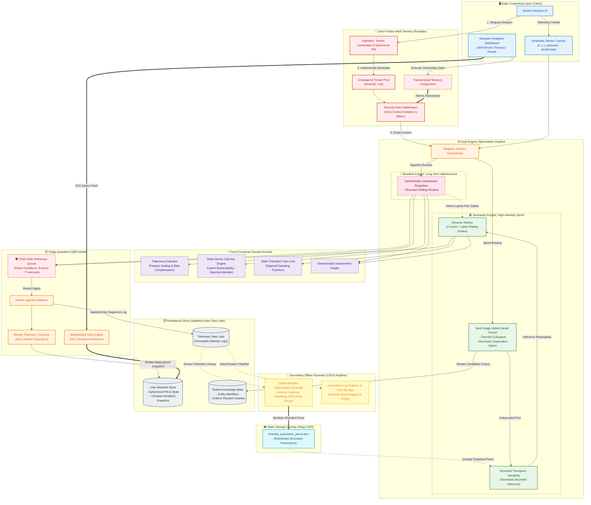

# High-Throughput Adaptive Learning Architecture with Edge-Guarded CQRS

© 2026. All rights reserved.

> **Notice:** The core application code, proprietary user engagement logs, and private adaptive algorithms are maintained in a secure, private repository for intellectual property protection and active commercial commercialization. This public repository serves exclusively as a system architecture blueprint, decoupling specification, and technical showcase for graduate-school portfolio review. Unauthorized duplication or commercial adaptation is strictly prohibited.

---

## 1. Architectural Philosophy & Production Bottlenecks
Standard full-stack implementations of adaptive personalization algorithms often crumble under concurrent client write pressures, leading to severe **write amplification** and API quota exhaustion on modern document-oriented databases. Furthermore, calculating continuous group-level statistical benchmarks during runtime loops introduces highly inefficient $O(N)$ computational overhead.

This system handles these challenges via an **Edge-Guarded Lambda-Style Pipeline**. By combining a low-latency client-side debounce queue with a strict **CQRS (Command Query Responsibility Segregation)** pattern, the system separates mutable tracking logs from real-time read snapshots. Macro-level statistical parameters are decoupled entirely from the operational engine and overlaid asynchronously via localized edge resources.

---

## 2. End-to-End System Topology

The pipeline utilizes client-side edge computing, deterministic-stochastic dual-engine routing, isolated pure domain algorithms, and an automated serverless flywheel to preserve persistence cycles.

---

## 3. Core Architectural Mechanisms

### A. Dual-Engine Prior Inheritance (Exploration-Exploitation)
To optimize long-term cognitive modeling alongside explosive multi-user training bursts, the system orchestrates an asynchronous prior-inheritance bridge. The *Baseline Engine* establishes highly stable retention decay parameters using deterministic interleaved repetition matrix tracking. When a user switches to a high-intensity session, the *Stochastic Engine* maps these parameter inputs as empirical prior vectors ($\alpha, \beta$) into a *Bounded Thompson Sampling* loop. This guarantees balanced stochastic exploration without experiencing common cold-start evaluation failures.

### B. Client-Side Debounce & Atomic Ingestion CQRS
High-frequency writing of multi-dimensional telemetry data points (coordinates, pressure vectors, timestamps) to cloud persistence layer is bounded by a client-side *Edge Debounce Queue*. Transactions flush strictly under combined $N$-item thresholds or $T$-second time windows. 

Upon flushing, the AttemptBatcher executes an immutable append operation to the raw telemetry data lake. Simultaneously, an asynchronous stream truncator calculates a condensed 30-item sliding footprint, writing a localized User Manifest Store snapshot. This ensures that administrative dashboards can extract real-time tracking metrics at deterministic $O(1)$ query execution bounds.

C. Serverless Offline Flywheel Integration

Calculating cross-user distribution metrics and normalization transformations is moved out of the live request cycle entirely. An automated, scheduled asynchronous task flow (GitHub Actions Flywheel) extracts large-scale raw performance histories, processes composite Recency Decays and Inverse Variance Weightings offline, and compiles the outcomes into compressed static files (sharded_population_priors.json). These configuration files are overlaid onto the production ranks at runtime via edge nodes, eliminating live calculation costs.
